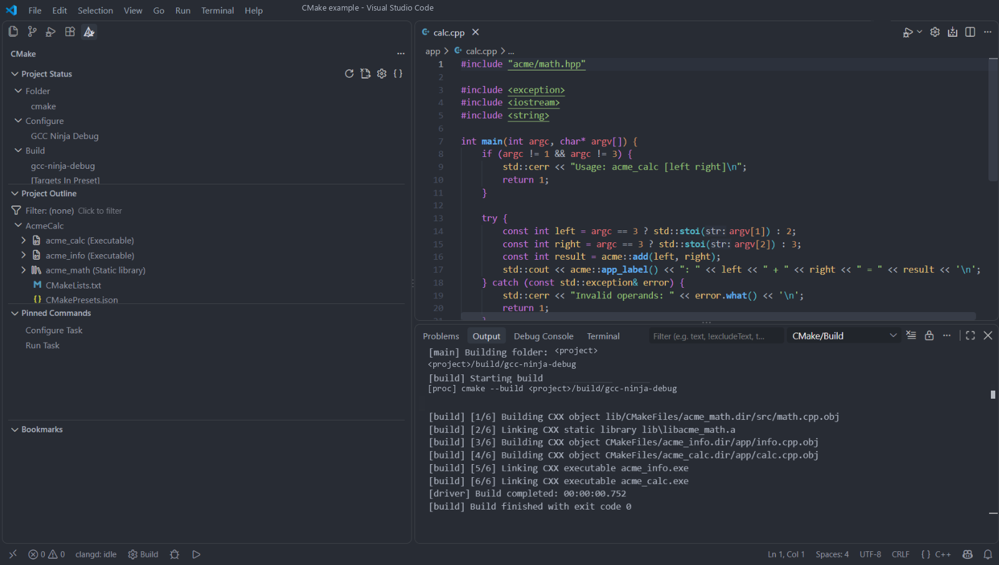
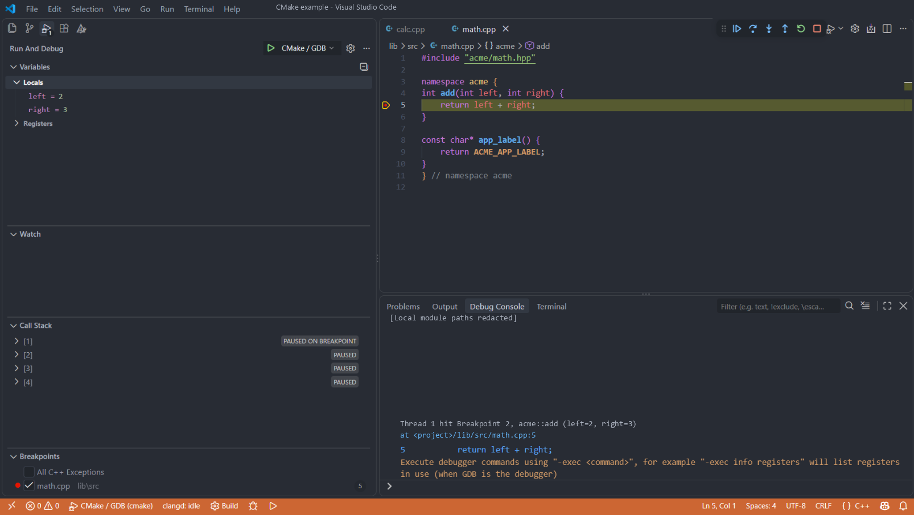
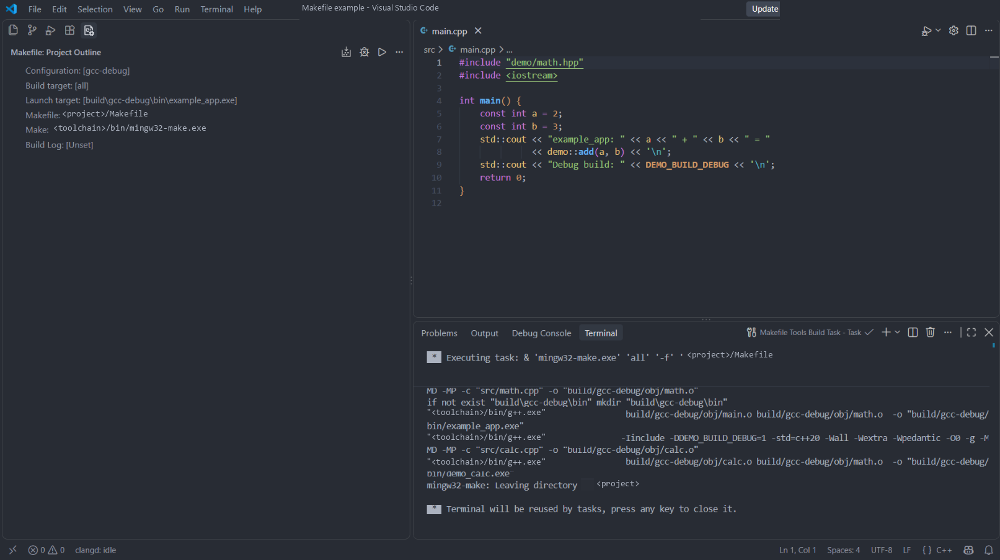
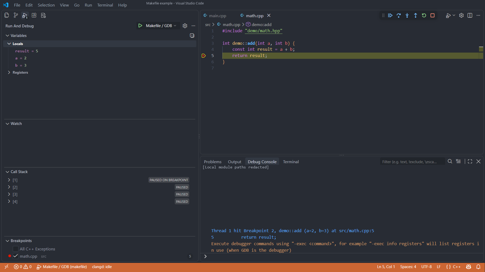

# VS Code C++ Development Environment Configuration

This repository provides two sets of development environment guides, based on CMake Tools and Makefile Tools. Both cover Windows, Linux, and Linux development over Remote-SSH. Choose the guide that matches your project's build system.

| Project build system | Configuration guide |
| --- | --- |
| CMake | [CMake Tools guides and examples](cmake-tools-vscode-cpp-development-environment/README.md) |
| GNU Make / Makefile | [Makefile Tools guides and examples](makefile-tools-vscode-cpp-development-environment/README.md) |

Both approaches use clangd for language services and support debugging with GDB or CodeLLDB. Each directory contains platform-specific instructions and example projects. See its README for installation and usage details.

## Build and Debug in VS Code

The screenshots below show the repository's Windows examples running with GCC and GDB. Follow the workflow from selecting a build configuration to inspecting local variables at a breakpoint. Local paths and account details have been redacted; `<project>` and `<toolchain>` represent the example folder and compiler installation.

### CMake Tools

With the `gcc-ninja-debug` preset selected, CMake Tools builds the example with GCC and Ninja. The sidebar shows the active configuration and project targets, while the Output panel confirms that both `acme_calc` and `acme_info` were built successfully.



Once the build completes, select `acme_calc` as the launch target and start the `CMake / GDB` configuration. Here, execution is paused in the addition function: the highlighted line marks the next statement, and the Variables view shows `left = 2` and `right = 3`.



### Makefile Tools

The same workflow starts with the `gcc-debug` configuration in Makefile Tools. After configuring the project, building `all` produces both `example_app` and `demo_calc`. The Project Outline view shows `all` as the build target and `example_app` as the separately selected launch target.



Starting `Makefile / GDB` then launches `example_app`. At the breakpoint on `return result;`, the Variables view shows the inputs `a = 2` and `b = 3`, along with the calculated `result = 5`.



## Repository Structure

```text
vscode-configuration/
├── assets/
│   └── screenshots/
├── cmake-tools-vscode-cpp-development-environment/
├── makefile-tools-vscode-cpp-development-environment/
└── README.md
```

## Getting Started

Open the directory for your build system and read its README, then choose the guide for your operating system. To run an example, open that individual example project in VS Code and follow the guide to configure, build, and debug it.
